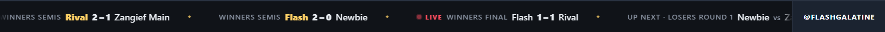

# Zipper — tournament ticker for Streamer.bot

A scrolling ticker strip for OBS that shows **live results of an ongoing
tournament** — completed sets, matches in progress, and what's up next —
polled straight from the bracket site. Named after the Times Square news
"zipper."



- **Platforms:** Challonge and start.gg today (API or keyless), Matcherino
  standings; Round.one and TourneyBot planned.
- **Any width:** 1920px broadcast strip by default, `?w=640` for old-school
  layouts — one overlay file.
- **End caps:** optional static logo (left) and streamer-set text like a social
  handle (right); the middle scrolls. A long text ends in "…" at 40% of the
  strip's width. A logo that does not load hides the left cap. An update a
  minute or more later tries the logo again.
- **Top-N focus:** optionally show only matches involving the top-N placed
  participants (e.g. Top 4) — uses the platform's standings (start.gg always;
  Challonge via `final_rank` on your own keyed tournaments, or derived from the
  elimination order once a scraped bracket finishes).
- **Persistent message:** type a message in the control page and flip a
  checkbox to hold it on the strip instead of results ("bracket starts at 8pm",
  a Discord plug) — one line per ticker item. Results keep polling underneath
  and come back when you switch it off, the way new results come in (see *5.
  Drive it* below, which also has the one exception, just after a restart,
  before the bracket has been fetched once: with polling off, or with polling
  on while the first poll is under way or the bracket site keeps failing). It
  works with no tournament set at all.
- **Announcements:** subs, raids, milestones, or anything you type interrupt
  the crawl — the strip pauses, shows the alert with a kind pill, and resumes.
  Wire SB's own Twitch triggers to the `Ticker Announce` action for sub/raid
  alerts; milestone announcements poll StreamElements (JWT in `config.json`).
- **Streamer.bot-native:** three SB actions, plus an optional fourth, and a
  small Node sidecar. Overlays
  reconnect and repaint by themselves; last results survive an SB restart.

```
bracket site ──poll── zipper-sidecar.mjs ──DoAction──▶ Streamer.bot ──broadcast──▶ OBS overlay(s)
                             ▲                                                       + control page
                             └──────────── ticker:command (control page) ◀───────────┘
```

## Setup

Requires Node ≥ 20, Streamer.bot ≥ 1.0.4 (tested on 1.0.4 and 1.0.7 as of
Zipper 1.0.14; later releases were checked against a mock of Streamer.bot, and
the actions in this version have been compiled only against a stand-in, not
yet in Streamer.bot) with its **WebSocket Server** enabled
on `:8080` (authentication OFF) and its **HTTP Server** on `:7474`.

First, get the code onto the machine that runs Streamer.bot — either

```
git clone https://github.com/FlashGalatine/zipper-ticker.git
```

or click **<> Code → Download ZIP** on the repo page and extract it.

### 1. Streamer.bot actions

Create these actions — names must match exactly:

| Action name      | Sub-action | Paste |
|------------------|-----------|-------|
| `Ticker Push`    | Core → C# → Execute C# Code | [`actions/ticker-push.cs`](actions/ticker-push.cs) |
| `Ticker Command` | Core → C# → Execute C# Code | [`actions/ticker-command.cs`](actions/ticker-command.cs) |
| `Ticker Announce` | Core → C# → Execute C# Code | [`actions/ticker-announce.cs`](actions/ticker-announce.cs) |
| `Ticker Sidecar Start` *(optional)* | Core → C# → Execute C# Code | [`actions/ticker-sidecar-start.cs`](actions/ticker-sidecar-start.cs) |

Click **Compile** on each — all must report success. `Ticker Sidecar Start`
also needs `System.dll` added on its References tab (see the file's header);
edit its `BUNDLE` path and add SB's application-started trigger to auto-launch
the sidecar with Streamer.bot. It writes to Streamer.bot's log what it found:
a sidecar already running (nothing started), a `BUNDLE` without
`zipper-sidecar.mjs` in it, or, after the launch, whether the sidecar took its
port within about 3 seconds (if not, run `npm install` there, or run
`start-zipper.bat` once to see the error). An older paste keeps working;
re-pasting it is optional, and means entering `BUNDLE` again (`System.dll`
stays on the References tab).

**Put the three bus actions in one blocking queue.** In Streamer.bot's
**Action Queues** tab, add a queue with **Blocking** ticked, then set
`Ticker Command`, `Ticker Push` and `Ticker Announce` to use it
(`Ticker Sidecar Start` stays in the default queue). Streamer.bot can mix up
the arguments of two runs of the same action when they overlap; a blocking
queue runs them one at a time. Measured on Streamer.bot 1.0.7 with a test
action: back-to-back requests mixed their arguments in 25 of 25 tries in the
default queue, 0 of 25 in a blocking queue. The queue covers every sender: the
control page, chat, a Stream Deck, Twitch triggers and the sidecar.

**Restrict who can use the chat command.** If you add a `!ticker` chat command
(see [step 5](#5-drive-it) below), `Ticker Command` relays only five commands
from chat: `start`, `stop`, `pollNow`, `status` and `setTopN` (in any letter
case). Anything else typed in chat is refused, and Streamer.bot's log says so;
the tournament URL, the end caps and the message are set on the control page
or from a Stream Deck (a Stream Deck button sets the `command` and `value`
arguments; one that sets only `rawInput` is held to the five, as chat is, and
the log says to set `command` and `value` instead). `Ticker Command` does not
check who typed the command,
so in the command's own settings (Commands tab), set its permissions so only
**moderators** and the **broadcaster** can use it. Anyone the command allows
can stop and start polling, ask for a poll, and change the Top N filter. The
same applies to every other chat command you point at `Ticker Command`: a
dedicated `!pollnow` is relayed as `pollNow`, and one that is not on the list
is refused. A `Ticker Command` pasted before this version relays every
command from chat, so re-paste it.

### 2. HTTP maps

Streamer.bot → Servers/Clients → HTTP Server → add two Path→Folder maps
(the `zipper-` prefixes avoid collisions with other components):

| Path | Folder |
|------|--------|
| `zipper-overlay` | `<this repo>\overlay` |
| `zipper-shared`  | `<this repo>\zipper-shared` |

### 3. OBS source

Add a Browser Source:

```
http://127.0.0.1:7474/zipper-overlay/ticker.html?w=1920&h=72
```

Set the OBS source size to match: `?w=` width (default 1920), `?h=` height
(default 72). Use the http URL, not a local file — OBS `file://` sources ignore
`?w=`/`?h=` and friends.

### 4. Sidecar

```
npm install
start-zipper.bat        (or: npm run sidecar)
```

**The sidecar must be running** — it's what turns control-page clicks into
polls and pushes. If it isn't up, the control page shows a red banner, and the
Set, Start polling, Poll now, Stop, Options Apply, Apply caps and message Apply
buttons and the Auto start/stop and "Show this instead of results" checkboxes
do nothing (announcements still work, as those go Streamer.bot → overlay
without the sidecar). The `Ticker Sidecar Start` action above lets
Streamer.bot launch it for you. The banner says when the problem is
Streamer.bot instead: "Streamer.bot offline"; "Action missing" (an action from
step 1 is not there, or has another name); "Streamer.bot refused …" (any other
error answer, in Streamer.bot's own words); "A Zipper action failed in
Streamer.bot: … See Streamer.bot's log." (an action threw, or Ticker Push
refused what it was sent; Streamer.bot's log has the details); or "Ticker
Command did not answer" or "Ticker Announce did not answer" (check that its
code compiled). Two more lines come first when
they hold. One says the page did not connect at all, because the `?sbport=` in
its address is not a port from 1 to 65535 (an empty one too). The page then
dials nothing, not even the usual 8080: fix the number and reload. The other
says an older copy of `panel-core.js` is loaded, which OBS or the browser kept:
reload the dock, and if that does not help, restart OBS. If `panel-core.js`
did not load at all (the `zipper-shared` folder is not where the page looks
for it), the dot is red and the page says so. Under the status line
the page also says when an action is in Streamer.bot's Default queue (see
step 1), and how many clicks were not sent when the connection dropped.

Copy `config.example.json` → `config.json` for API keys (optional but
recommended: `challongeApiKey`, `startggApiKey` — without them Zipper falls
back to each site's public/keyless surface, which can be less reliable). The
sidecar copies it for you when `config.json` is missing. A key can also come
from the `CHALLONGE_API_KEY` or `STARTGG_API_KEY` environment variable, used
when `config.json` has none; the sidecar never writes it into `config.json`.
A key in `config.json` wins over the environment's, so a key an older version
of Zipper copied there from the environment overrides the variable until you
remove it from the file.

The sidecar saves the control page's settings in `config.json` too. When it
loads the file it pulls each number into range without a warning:
`pollIntervalMs` 15000 to 3600000 (milliseconds), `maxItems` 1 to 100, `topN`
0 to 100, `streamElements.pollSeconds` 5 to 3600, and each `milestones` step 0
to 1000000. A missing number takes the default. It cuts `caps.text` to 120
characters and `message.text` to 1000. A `caps.logo` that is not allowed is
dropped, and the control page shows a warning. `autoStart` is the sidecar's own
record of whether polling was on: when it is true and `tournamentUrl` is set,
the sidecar starts polling at launch. Every save writes the polling state at
that moment over it (Start, Stop, a stop once the event is over, or any other
change), so setting it by hand only decides the next launch.

**Edit `config.json` with the sidecar stopped, or restart the sidecar
afterwards.** It reads the file only when it starts. An edit made while it runs
is not loaded until the restart, and the sidecar leaves it as it is: it stops
saving the file until then (so a setting changed on the control page meanwhile
lasts only until the restart), and from the first save it skips the control
page shows a config warning.

A sidecar started with `start-zipper.bat` (or `npm run sidecar`) stops when you
close its window or press Ctrl+C in it. One that the `Ticker Sidecar Start`
action started runs hidden, with no window: end its `node.exe` in Task Manager
(on the Details tab; if several `node.exe` are listed, right-click a column
header, choose Select columns and tick Command line: that column shows the one
running `zipper-sidecar.mjs`), then run the action, or
`start-zipper.bat`, again. Running the action while a sidecar is up starts
nothing.

If `config.json` has a mistake in it (a trailing comma, a missing quote), is
saved as UTF-16 (Windows PowerShell's `>` and plain `Out-File` do that), is
empty, or is not saved as UTF-8 (an editor that saves as ANSI does that when
the file has an accented letter in it), the sidecar does not touch the file: it
runs on its built-in settings, without the keys from the file or from the
environment, saves nothing, and the control page shows a warning such as
"config.json is not valid JSON (line 4)", "config.json is saved as UTF-16; save
it as UTF-8", "config.json is empty" or "config.json is not saved as UTF-8;
save it as UTF-8". A file of plain ASCII saved as ANSI loads.
Fix or replace the file, then restart the sidecar. If the warning adds "a whole
copy of the settings is in config.json.tmp", a save was cut short (by a crash,
or by another program locking `config.json` while the sidecar wrote it) and left
that file, holding the settings it was saving. To use it, delete or rename the
broken `config.json`, rename `config.json.tmp` to `config.json`, then restart.
If `config.json` is missing while such a copy is there, the sidecar does not
copy the example in and says "config.json is missing": rename the copy to
`config.json` the same way, or delete `config.json.tmp` to start from the
example, then restart.

A key with a space, a line break or another character that is not printable
ASCII inside it (a tab, a non-breaking space, an accented letter), in
`config.json` or in an environment variable, is not used. The rest of
`config.json` loads and saves as usual, and the key stays in the file as it
is. The control page's warning says where the key came from, such as
`challongeApiKey in config.json`, without showing the key. A key refused in
`config.json` is not replaced by the environment's. Paste it again.

The sidecar writes what it does to `config.log`, beside `config.json`; once that
passes 1 MB it is moved to `config.old.log` and started again. The keys
in `config.json` and in the two environment variables (8 characters or more)
are replaced by a label there, such as `[start.gg key]`. The sidecar saves `config.json` by writing a
new file over it, so a hard or symbolic link to the old file, or permissions set on
the file itself, are not kept. If the sidecar stops by itself after it has
started, the reason is the last line there. A sidecar that cannot start at all
(most often because `npm install` has not been run, so its `ws` package is
missing) writes nothing there, so the last line is left over from an earlier
run: run `start-zipper.bat` once to see the error.

After upgrading from a version older than 1.0.24, press **Poll now** once (it
turns polling on and leaves it on). Streamer.bot keeps the last payload it was
sent and replays it to the overlay; the first new push replaces a copy stored
by an older version, which did not replace keys by labels. With polling on, the
first good poll after the restart makes that push by itself; with polling off
and the message on, the sidecar makes it when it connects to Streamer.bot.
**Set** with the URL already set pushes nothing.

### 5. Drive it

Open the control page — in a browser or as an OBS custom dock:

```
http://127.0.0.1:7474/zipper-shared/control.html
```

A box you type in keeps what you typed, and is marked, until the sidecar
reports the value you applied; press Esc in it to put back the current value.

Paste the tournament URL (e.g. `https://challonge.com/blko42` or
`https://www.start.gg/tournament/…/event/…`), **Set**, **Start polling**. A
Challonge address with a language in it, such as
`https://challonge.com/fr/blko42`, is not handled yet: it is read as the
tournament `fr`. Paste it without the language part:
`https://challonge.com/blko42`. An address pasted without `https://` gets it (the box then shows it that way), and
a start.gg admin page's address works too. A start.gg tournament URL works when
the tournament has one event; when it has several, the status line says "paste
a specific event URL" and names them: paste that event's own URL. **Set**
with a new URL clears the old tournament's results from the strip at once (the
end caps and the message stay), so an old bracket never crawls under a new
event's name; the new results appear with the first good poll. Set
the end-cap text/logo and the persistent message there too; end-cap changes show
on the strip at once, and option changes reach it as new results do (see the next
paragraph), even while the bracket site is failing (just
after the sidecar starts, before it has fetched the bracket once, a change waits
for that fetch). The message is the exception: when the sidecar starts with the
persistent message on and polling off, it pushes the message at once, on a
payload with no results, which replaces the results Streamer.bot kept (a message
edit before the first good fetch, polling or not, does the same). The strip brings the message in
as it does new results (see the next paragraph). From then on an end-cap
change shows at once on that payload. Switching the message off puts the
"waiting for results" line on the strip at once, with no results, until the
bracket is fetched again: **Start polling**, **Poll now**, or an option change.
Chat control also works — point a `!ticker` command trigger at the `Ticker Command` action and type
`!ticker pollNow`, `!ticker setTopN 4`, `!ticker stop`, etc. Chat may send
only `start`, `stop`, `pollNow`, `status` and `setTopN` (see step 1); the rest
stays on the control page and a Stream Deck.

The logo is an http(s) address, or a path on Streamer.bot's HTTP server. To use
your own image, put it in the overlay folder (for example
`<this repo>\overlay\assets\logo.png`, in an `assets` folder you create) and
enter `/zipper-overlay/assets/logo.png`. Anything else (a `data:` or `file:`
address, or a Windows path such as `C:\logo.png`) is refused: the old logo
stays, and the status line says why. Use a PNG or JPG: Streamer.bot (measured
on 1.0.7) serves `.svg` files as `application/octet-stream`, with no image
type, so an SVG logo served from there does not show and the left cap stays
hidden.

New results never cut into the crawl. The same goes for an option change and for
the message going on or off. When the loop is about to wrap (in 20 seconds or
less), they wait for it and then scroll in from the right. When the wrap is
further off, the crawl fades out for a moment and comes back with them, at the
place it had reached (the end caps stay). So updates that come often do not send
the crawl back to its start, and the end of a long list still scrolls into view.
An update that holds the same results as the strip changes nothing. A strip
with nothing to crawl shows its "waiting for results" line at once. That is the
blank strip after a new URL, or the message switched off on the payload with no
results (above). The first crawl after that line, results or the message, shows
at once too. While an announcement is up, an update that changes what the strip
shows (new results, an option change, the message going on or off) goes in
under the bar at once. So does one still waiting for the wrap or the fade when
the announcement came. The crawl then comes back from its first item. With
nothing new, it comes back where it paused.

**Auto start/stop** (the checkbox next to the polling buttons, on by default)
keeps API calls to a minimum: start polling any time — before the event begins
the sidecar waits for the platform's advertised start time, checking again every
15 minutes (or at your poll interval, if that is longer) so a bracket that starts
early is picked up (every 5 minutes if there is no start time, or at your poll interval if that is longer), and once the
event completes it pushes the final results and stops polling by itself. The
results stay on the strip. To
turn it off, untick the checkbox on the control page. **Start polling** /
**Poll now** get a fresh poll even before the start time or after that stop,
but no poll comes sooner than 15 seconds after the last one (a click inside
that gap is polled when it ends). When a site answers "too many requests" (or
"unavailable") with a time to wait, Zipper waits that long before polling that
site again, **Poll now** included, up to 5 minutes, or the poll interval if
that is longer.

### 6. Persistent message (optional)

Type into the control page's **Persistent message** box — one line per ticker
item — and tick *Show this instead of results*. It holds the strip until you
untick it; results keep polling underneath and come back the way new results do:
they wait for the crawl's next wrap, or come in under a short fade (except just
after a restart, before the bracket has been fetched once, as described above).
No
tournament needs to be set, so it doubles as a plain message ticker. The
message is set on the control page, or from a Stream Deck with the
`setMessageText` and `setMessageEnabled` commands (see
[the wire protocol](docs/PROTOCOL.md)); chat cannot set it.

### 7. Announcements (optional)

- **Sub/raid alerts:** in Streamer.bot, add the `Ticker Announce` action to
  your Subscription, Resubscription, Gift Subscription, Gift Bomb and Raid
  triggers — it composes the text from the trigger arguments ("UserName is
  raiding with 25 viewers!", "UserName just subscribed!", "Gifter gifted a sub
  to Recipient!"), or pass an explicit `text` argument to customize. A gift
  bomb is announced once, by the Gift Bomb trigger ("Gifter gifted 5 subs!");
  the Gift Subscription runs that belong to it announce nothing, so add both
  triggers. Add the two gift triggers only after the `Ticker Announce` from
  this version compiles: one pasted before it sends "Gifter just subscribed!"
  once per gift of a bomb. (The overlay shows that repeated line once, since it
  drops an announcement identical to the one just before it; a custom `text`
  that names each recipient would still show once per gift.) Add them only
  once the three bus actions are in the blocking queue of step 1, too: a
  bomb's runs come together, and in the default queue they can mix their
  arguments, so the Gift Bomb run can read a gift sub's `fromGiftBomb` and be
  skipped as well, and the bomb is not announced at all. An anonymous gift
  reads "Someone" (as a missing name does), whatever name Streamer.bot gives
  with it. The arguments were checked with Streamer.bot's Test Trigger on
  1.0.7, not against a live gift bomb: how a live bomb's runs arrive, and
  what name Streamer.bot gives an anonymous gift, were not seen. If a live
  bomb's Gift Subscription runs did not carry `fromGiftBomb`, the strip would
  show several "Gifter gifted a sub to Recipient!" lines, one per recipient,
  beside the bomb's own line (the strip keeps at most ten announcements
  waiting and drops any more, so a large bomb would show fewer of them and
  could lose the bomb's own line); whether they carry it was not seen on a
  live bomb. Test Trigger
  on Gift Subscription gave `fromGiftBomb` as true when it was tried, so that
  test is skipped and shows nothing; Test Trigger on Gift Bomb shows the
  bomb's line.
- **Milestones:** put your StreamElements JWT in `config.json` as
  `"streamElements": { "jwtToken": "…" }` (streamelements.com → account →
  Channel settings → Show secrets) and set step sizes under `"milestones"`
  (`followers`, `subs`, `tips`, `cheers`; 0 = off), e.g.
  `"milestones": { "followers": 100, "subs": 25 }`. The first check after a
  metric is set up only records where its counter stands; after that, each
  check announces the highest new step the counter has reached (one
  announcement per metric per check, so a jump past several steps announces
  only the top one). Announced steps are kept in `config.json`, so a restart
  does not repeat them. While saving the file has stopped or fails (the control
  page then shows a config warning), they are not saved, and a restart can
  repeat one. Edit the file with the sidecar stopped, or restart it
  afterwards (see step 4). The token stays in the file;
  it is never broadcast, and never written to the log.
- **Manual:** the control page's Announcement box sends anything you type.
  The text stays in the box until the announcement comes back from
  Streamer.bot, then the box clears. A second click on Send while the same
  text is still on its way sends nothing, so it is not shown twice.
- **Repeats:** an announcement identical to the one before it (the same kind
  pill, text and duration), sent while that one is still on the strip or waiting
  for its turn, is shown once. Sent again after it has gone, it shows again.

## Platform notes

| Platform | Status | Path |
|----------|--------|------|
| Challonge | ✅ | API (`challongeApiKey`; your own tournaments only — others 404 and auto-fall back) or keyless bracket-embed scrape |
| start.gg | ✅ | API (`startggApiKey`) or keyless public gql proxy¹ |
| Matcherino | ✅ standings-only | public JSON endpoint (no per-match data) |
| Round.one | 🔜 planned | public tournament JSON — match shape research pending |
| TourneyBot | 🔜 planned | `__NEXT_DATA__` scrape — match shape research pending |

¹ The keyless start.gg proxy may reject the sets query; if it 400s, add an API
key (start.gg → developer settings).

start.gg's sets are read newest first, 50 at a time, and the reading stops once
it holds enough finished sets for the strip (**Max ticker items**); with **Top N**
on, every page is read. At most 500 sets are read in one poll. When a poll reads
all 500 and more remain (with **Top N** on, or when those 500 hold fewer finished
sets than **Max ticker items**), the control page's status line says so, and the
strip shows the newest. A poll that stops early because it has enough says
nothing, however big the event. The standings come with the first 50: 8 of
them, or as many as **Top N** when that is more. After a poll that stopped
early, raising **Max ticker items** above what it was read with, or switching
**Top N** on, redraws the strip from what was read and fetches the event again,
polling or not, as soon as the 15-second gap after the last poll (and any wait
a site asked for) allows, and so does raising **Top N** above the standings
asked for, after any poll. Once the event has
been read, any other option change only redraws the strip from what was read.

## Dev & tests

```
npm start               # mock Streamer.bot on 7474/8080, Streamer.bot's own ports (see below) + sample data at /mock/fixture
npm run verify          # normalizer fixtures, panel-core, sidecar E2E — no network
npm run verify:render   # real-pixel screenshots at 1920/640 (after npm install; needs Edge or Chrome, or run once: npx playwright-core install chromium)
npm run verify:cs       # compiles the C# actions and runs them (Windows, .NET Framework)
npm run shots           # regenerate docs/ screenshots (after npm install; same browser need)
```

The mock takes Streamer.bot's own ports. With Streamer.bot running it cannot
start, and with Streamer.bot closed, a sidecar, overlay or control page that is
still running connects to it. Run it on side ports instead:
`set SB_HTTP_PORT=7476&& set SB_WS_PORT=8082&& npm start` (PowerShell:
`$env:SB_HTTP_PORT=7476; $env:SB_WS_PORT=8082; npm start`), then open
http://127.0.0.1:7476/. Its links carry `?sbport=`, and it shows the sidecar
command for that port. `npm run verify`, `npm run verify:render` and
`npm run shots` start their own mock on those same ports, and stop at once
(testing nothing, or taking no screenshot) when anything answers there, so stop
such a mock before running them.

Docs: [wire protocol](docs/PROTOCOL.md) · [theming](docs/THEMING.md)

## Author & support

Built by **Ashe "Flash" Galatine**.

- Email — [AsheJunius@gmail.com](mailto:AsheJunius@gmail.com)
- X — [@FlashGalatine](https://x.com/FlashGalatine) · BlueSky — [@projectgalatine.com](https://bsky.app/profile/projectgalatine.com)
- Twitch — [FlashGalatine](https://www.twitch.tv/FlashGalatine) · Discord — [Project Galatine](https://discord.gg/K6pRfSvu2Q)
- Support — Patreon [ProjectGalatine](https://www.patreon.com/ProjectGalatine) · CashApp [$ProjectGalatine](https://cash.app/$ProjectGalatine)

## Credits & license

MIT — see [LICENSE](LICENSE). The tournament platform matchers/scrapers are
adapted from the roster importer in [StreamScoreboard](https://github.com/FlashGalatine)
(same author, MIT), extended here to read live match results. Sole runtime
dependency is [ws](https://github.com/websockets/ws) (MIT). See
[THIRD_PARTY_NOTICES.md](THIRD_PARTY_NOTICES.md).
